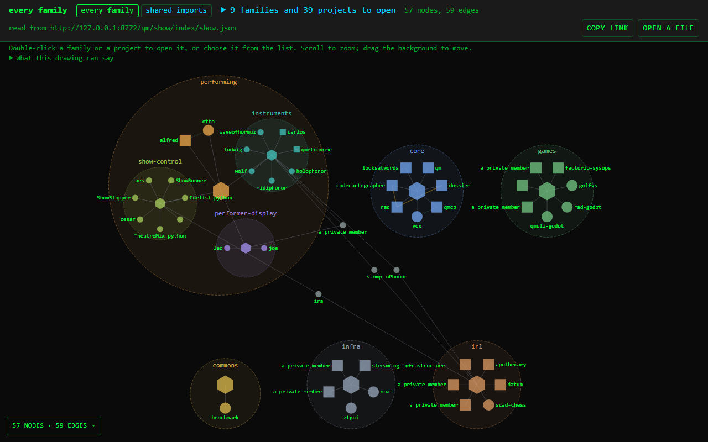
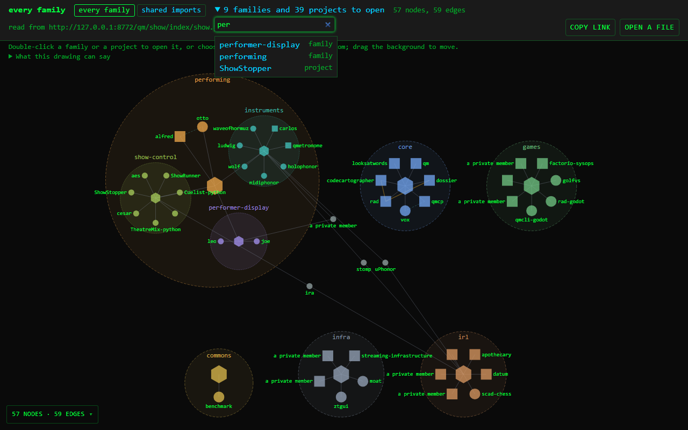
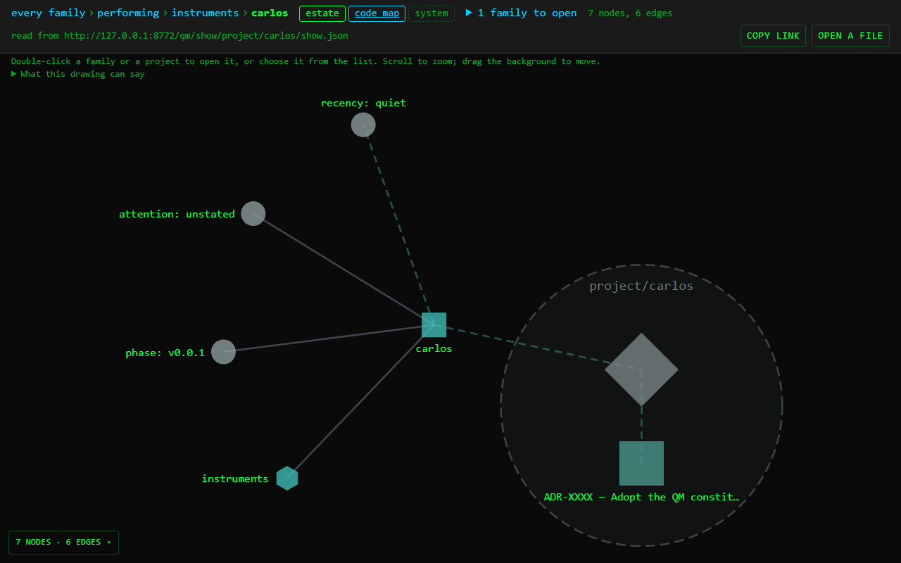
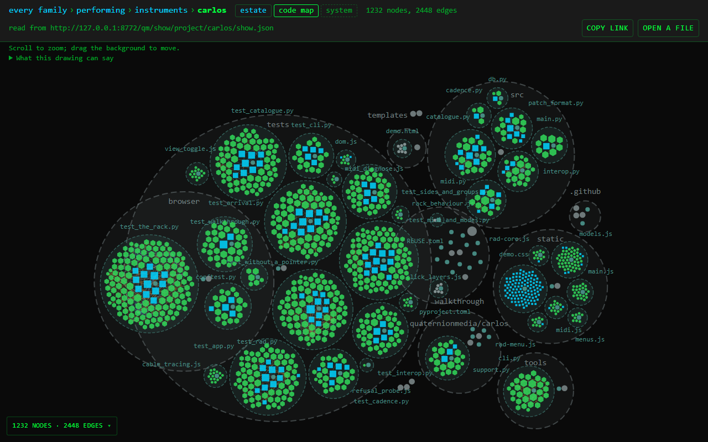
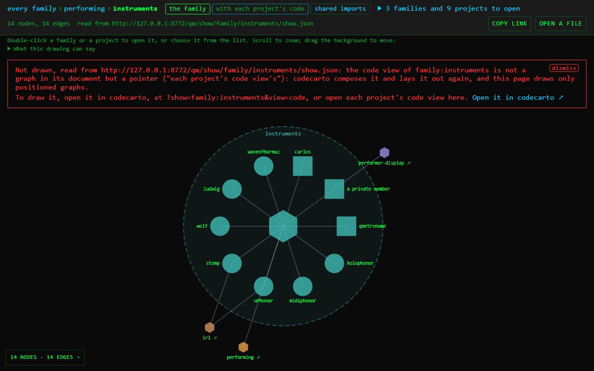

# Journeys

Each way a person uses codecarto through its UI, from where they start to
where they arrive, a step at a time. Codecarto has two front ends:

- [the page](view.md), `view.html`, which needs no server;
- [the window](ui.md), which a person running codecarto opens.

Each of the page's journeys below is walked by a browser test of the same
name, in `web/tests/e2e/view.spec.ts`. `tests/test_journeys.py` holds this
page and those tests to each other: a journey written here with no test
fails it, and so does a test with no journey.

## Where to start

| to | start at | journey |
|---|---|---|
| see what the corpus holds | the page, `https://quaternionmedia.github.io/codecartographer/` | [Every family](#every-family) |
| read a project's code | the page; its list, or a double-click | [Down to a project's code map, and back](#down-to-a-projects-code-map-and-back) |
| open a link someone sent | the link | [A link, and up its trail](#a-link-and-up-its-trail) |
| send someone what is drawn | **copy link** | [The address of what is drawn](#the-address-of-what-is-drawn) |
| see a project's system, or a family's code | the page sends it to the window | [A view the page does not draw](#a-view-the-page-does-not-draw) |
| draw a document of one's own | the page; **open a file**, a drop or a paste | [A document of one's own](#a-document-of-ones-own) |
| do all of it without a mouse | the page | [From the keyboard](#from-the-keyboard) |
| parse a repository, tune the drawing, read it | the window, `uv run codecarto serve` | [The window's four steps](#the-windows-four-steps) |

## The page

The page's bar says where the drawing is and what can be done from it, left
to right:

- **the trail**: from *every family* down to what is drawn, each step a link
  back up;
- **the views** of what is drawn, the one drawn pressed, as the window's
  [Show panel](ui.md#show) names them;
- **the list** of families and projects the drawing names, folded under its
  count, such as *3 projects to open*;
- what is drawn, counted, and who handed the page its document;
- **copy link** and **open a file**.

Under the bar, a line says what the canvas does: a double-click on a family or
a project opens it, a scroll zooms, and a drag on the background moves the
drawing. *What this drawing can say* folds the producer's caveat and where the
document was drawn, as the window folds them.

Every step rewrites the address, so a copied address reopens the drawing, and
adds a history entry, so **Back** and **Forward** walk the drawings. The page
reads each document once a visit, so a step back draws at once.

### Every family

**Starts at** the page's own address. **Arrives at** every family, drawn.

1. The page opens on the corpus's index: every family, from the show folder
   published beside it (`../qm/show/` on GitHub Pages).
2. The bar's trail reads *every family*; its views are *every family*, pressed,
   and *shared imports*.
3. The list's count says how many families and projects can be opened from
   here.

With no show folder beside it, on another host, the page opens on its ways in
instead, and says what it could not read.

Walked by `journey: a reader at the page's own address sees every family, and what can be opened from it`.

### Down to a project's code map, and back

**Starts at** every family. **Arrives at** a project's code map, and back.

1. Open the list, type part of a family's name, and choose it. The family is
   drawn, and the trail reads *every family › infra*.
2. Double-click one of its projects on the canvas, or choose it from the list.
   The project's estate is drawn: the trail reads *every family › infra ›
   ztgui*, and its views are *estate*, *code map* and *system*.
3. Press **code map**. The code map is drawn at the positions its document
   gives, as the window draws it.
4. **Back** draws the estate again, then the family, then every family.

Walked by `journey: a reader walks down from every family to a project's code map, and Back walks up again`.

### A link, and up its trail

**Starts at** a link to a subject, such as a family nested in another
(`view.html?show=family:instruments`). **Arrives at** the families that hold
it.

1. The link's subject is drawn.
2. The trail reads *every family › performing › instruments*. A family's own
   document does not say what holds it, so the page reads the index once, in
   the background, to complete the trail.
3. Each step of the trail is a link: *performing* draws that family, and
   *every family* the index.

Walked by `journey: a reader who follows a link to a nested family steps up its trail`.

### The address of what is drawn

**Starts at** any drawing reached by an address. **Arrives at** the same
drawing, opened by someone else.

1. Press **copy link**. The button says *copied*, and the clipboard holds the
   page's address, its view included.
2. Opened anywhere, that address draws the same view of the same subject, with
   the same trail.

A drawing opened from a file or a paste has no address, so the page offers no
link to copy.

Walked by `journey: a reader copies the address of what is drawn, and it opens the same drawing`.

### A view the page does not draw

**Starts at** a view the page cannot draw: a project's system, a family's
code, or a subject the show folder holds no document for.
**Arrives at** the reason, and a link to the window.

1. Views the page does not draw are offered with a dashed border. Pressed,
   one says why it is not drawn here, and what is drawn stays drawn.
2. A link to such a view, followed, draws the subject's first view the page
   can draw under the refusal, and the address names what is drawn.
3. **Open it in codecarto ↗** opens the same address in the window, where
   `codecarto serve` runs on this machine (`http://localhost:2718/app`).
4. **dismiss** folds the refusal away.

Walked by `journey: a reader shown a view the page cannot draw is told why, and where it is drawn`.

### A document of one's own

**Starts at** a show document or a gJGF graph on disk or on the clipboard.
**Arrives at** its views, drawn.

1. Press **open a file**, drop the file on the page, or paste the document.
2. It is drawn, and the bar names it and says it came from a file or a paste.
3. A show document's views are offered, and each is drawn from the document
   in hand. A file has no address, so the trail, the list and **copy link** are
   not offered.

Walked by `journey: a reader's own document, opened from a file, has its views drawn in hand`.

### From the keyboard

**Starts at** every family, with no mouse. **Arrives at** a project.

1. Tab to the list's count and press Enter: the list opens with the focus in
   its filter.
2. Type part of a name. When the filter leaves one name, Enter opens it.
3. Escape folds the list, and gives the focus back to its count.

The trail, the views, the list's names, **copy link** and **open a file** are
each a link or a button, reached with Tab and pressed with Enter.

Walked by `journey: from the keyboard alone, a reader filters the list and opens a project`.

## The window

### The window's four steps

**Starts at** `uv run codecarto serve`, opened at `/app`. **Arrives at** a
repository's graph, read.

The window leads from opening source to reading its graph in four numbered
steps on its header's rail, **Open**, **Browse**, **Tune** and **Read**, and
**Next** names the step after the one on. [The steps](ui.md#the-steps) says
what each brings forward, and [the Open panel](ui.md#open) every way in: a
GitHub URL or a local path, the demo and the lexicons, or an example; files
and folders from disk are added in [the Files panel](ui.md#files).

The window draws what the page sends it: a project's system, a family's code,
and the whole corpus, at the same `?show=` address the page uses
([Show](ui.md#show)).
